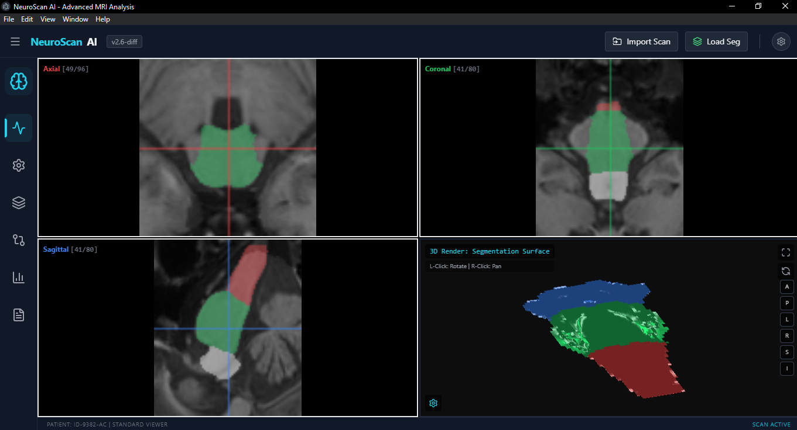

# NeuroScan AI

<div align="center">



Electron + React desktop viewer for MRI (and other volumetric) NIfTI and DICOM.

[](https://github.com/robbinc91/neuroscan-ai)
[](https://www.electronjs.org/)
[](https://reactjs.org/)
[](https://www.typescriptlang.org/)

</div>

Not a certified medical device. Use for research and development only.

---

## What it actually does

- **Formats:** NIfTI (`.nii`, `.nii.gz`) and DICOM (`.dcm`, `.ima`, extensionless DICM). Folder / DICOMDIR import with a series picker when more than one SeriesInstanceUID is present.
- **Viewing:** Four-up, axial, sagittal, coronal, and 3D raycasting. Patient-space MPR along the affine (not voxel-axis slices). 3D bounding box from the affine (oblique / anisotropic DICOM is an OBB). Radiological or neurological display. Cine. Window/level presets.
- **2D tools:** Pan, zoom, window/level, crosshair, in-plane ruler (patient mm), brush / eraser with stroke undo.
- **Processing (local worker):** tiled CLAHE, histogram match/equalize, gamma, sigmoid, 3D Gaussian, 3D unsharp (σ in mm), 3D median, Chambolle TV-L2, hierarchical N4-style bias correction (optional ITK-WASM if that package is installed). Not implemented: anisotropic diffusion, non-local means, region growing, generic “edge detection.”
- **Segmentation:** manual paint (labels 1–9), global thresholds (binary, Otsu, Li, multi-Otsu), local adaptive Gaussian. Optional **external** inference against a user-configured server (`POST /jobs` with poll, else `POST /predict`).
- **Analysis / export:** whole-volume histogram and intensity stats; optional GM/WM SNR/CNR; Dice / volume change in comparison mode; NIfTI gzip export; PDF / CSV / presentation-pack export. Exports default to de-identified patient lines (toggle in Analysis / Reporting).
- **Reporting:** optional Gemini draft from **segmentation volumes and intensities plus exam geometry** (matrix, spacing, modality, coordinate system). It does not send pixel data, and it does not send patient name, ID, DOB, or accession.
- **Session:** recent files, last layout, window/level, display convention.

---

## Requirements

- Node.js 18+
- npm
- Desktop run: `npm run dev` starts Vite + Electron. This is not a browser-only app.

```bash
git clone https://github.com/robbinc91/neuroscan-ai
cd neuroscan-ai
npm install
npm run dev
```

Gemini is optional. Paste an API key in **Settings** (gear). It is stored with `electron-store`, not `.env.local`.

### Production builds

```bash
npm run package:win    # NSIS
npm run package:mac    # DMG
npm run package:linux  # AppImage
```

Output goes to `release/`.

---

## Usage (short)

| Action | How |
|--------|-----|
| Open a scan | **Import Scan**, **Import Folder / DICOMDIR**, drag-and-drop, or File > Open |
| Navigate slices | Scroll, arrow keys, cine (Space) |
| Pan / zoom | Pan tool or middle-drag; Zoom tool or Ctrl+wheel |
| Window/level | W/L tool, right-drag, or presets |
| Paint | Segmentation → Manual drawing; Ctrl+Z / Edit > Undo undoes the last stroke, then the last processing step |
| Cloud model | Segmentation panel: set server URL, fetch `/models`, Run Inference |

Layouts: `0` four-up, `1` axial, `2` sagittal, `3` coronal, `4` 3D.

---

## Privacy (accurate)

| Path | What leaves the machine |
|------|-------------------------|
| Viewing, processing, local segmentation | Nothing. All of it runs locally (filters in a Web Worker). |
| Gemini reporting (if you set a key) | Text only: label names, volumes (cm³), intensity mean/SD, matrix, spacing, modality, coordinate system. **Not** voxels, **not** patient name/ID/DOB/accession. |
| External `/predict` or `/jobs` | The **voxel volume** plus dimensions, `model_id`, and geometry JSON to the URL you type. That is not anonymized metadata; treat the endpoint as you would any clinical data processor. |
| PDF/CSV/pack export | Patient name/ID omitted when **Anonymize exports** is on (default). Local metadata sidebar still shows DICOM tags. |

---

## Stack

Electron 28, React 19, TypeScript, Vite, Tailwind, nifti-reader-js, daikon, lucide-react, recharts, jspdf, html2canvas, `@google/genai`, electron-store.

---

## Layout

```
App.tsx
components/          Viewport, panels, dialogs
electron/            main process, preload, menus
utils/               NIfTI/DICOM, MPR, filters, jobs, reports
workers/             volume processing worker
services/            Gemini draft (PHI-safe prompt)
BACKEND_SPEC.md      optional inference HTTP API
```

---

## Troubleshooting

**App will not start.** Node 18+, delete `node_modules`, `npm install`.

**Scan will not load.** Use NIfTI or DICOM with pixel data. Multi-series folders need a series pick. Prefer **Import Folder** for a DICOMDIR tree.

**Gemini draft is simulated.** No key in Settings → you get a local placeholder, not a model call.

**Inference fails.** The server must implement `GET /models` and either `POST /jobs` + `GET /jobs/{id}` or `POST /predict` as in `BACKEND_SPEC.md`.

---

## Support

- [Documentation (this repo)](https://github.com/robbinc91/neuroscan-ai)
- [Issues](https://github.com/robbinc91/neuroscan-ai/issues)
